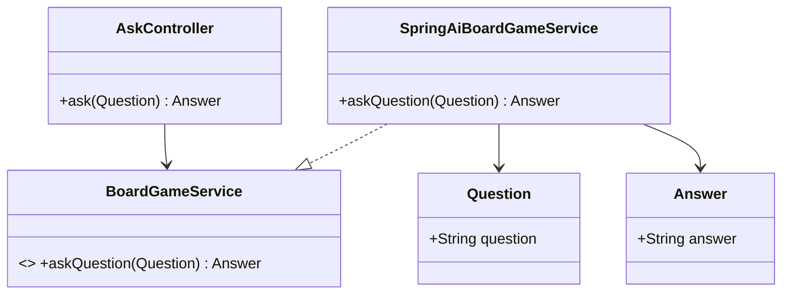

# Chapter 1 — Getting started with Spring AI

## Ringkasan teori

Aplikasi ini menunjukkan alur pemanggilan model AI dari Spring Boot: controller menerima pertanyaan, service menerjemahkan permintaan ke `ChatClient`, dan ChatClient mengirim prompt ke model (OpenAI atau Ollama). `BoardGameService` memisahkan kontrak aplikasi dari implementasi Spring AI, sehingga controller tidak bergantung langsung pada provider/model.

## Struktur dan hubungan kelas



Alur: HTTP JSON → `AskController` → `BoardGameService` → `SpringAiBoardGameService` → `ChatClient` → chat completion provider → `Answer` JSON.

## Persyaratan

- JDK 23 (Gradle toolchain sudah dikonfigurasi)
- Gradle wrapper yang tersedia di proyek
- Salah satu provider: Nararouter/OpenAI-compatible atau Ollama

## Konfigurasi

### Nararouter (OpenAI-compatible)

Jangan menaruh API key pada source atau konfigurasi yang akan dikomit. Set secret melalui environment variable pada sesi terminal:

```powershell
$env:NARAROUTER_API_KEY="<API_KEY_DARI_USER>"
$env:SPRING_AI_OPENAI_BASE_URL="https://router.bynara.id/v1"
$env:SPRING_AI_OPENAI_CHAT_MODEL="gpt-5.6-luna"
.\gradlew.bat bootRun
```

Konfigurasi default proyek sudah menunjuk ke Nararouter dan model `gpt-5.6-luna`; hanya `NARAROUTER_API_KEY` yang perlu disediakan. Base URL dan model tetap dapat dioverride melalui dua environment variable tersebut.

### Ollama

Ollama dapat digunakan sebagai provider lokal. Ubah dependency OpenAI menjadi Ollama pada `build.gradle`:

```gradle
implementation 'org.springframework.ai:spring-ai-starter-model-ollama'
```

Jalankan Ollama, ambil model, lalu set konfigurasi:

```powershell
ollama pull llama3.2
$env:SPRING_AI_OLLAMA_BASE_URL="http://localhost:11434"
$env:SPRING_AI_OLLAMA_CHAT_OPTIONS_MODEL="llama3.2"
.\gradlew.bat bootRun
```

Untuk memakai OpenAI standar, ubah `SPRING_AI_OPENAI_BASE_URL` dan model sesuai provider OpenAI. Dependency OpenAI tetap menentukan implementasi ChatClient.

## Menjalankan

```powershell
.\gradlew.bat bootRun
```

Endpoint default: `http://localhost:8080`.

## Memanggil REST API

PowerShell/curl:

```powershell
curl.exe -X POST "http://localhost:8080/ask" `
  -H "Content-Type: application/json" `
  -d '{"question":"What is the goal of a board game?"}'
```

Contoh respons:

```json
{"answer":"A board game is won by following its objective and outscoring or eliminating the opposition."}
```

## Test dan build

Test menggunakan WireMock untuk mengganti endpoint Nararouter/OpenAI-compatible dengan server lokal deterministik, sehingga test tidak memerlukan API key nyata dan tidak mengakses internet:

```powershell
.\gradlew.bat test
.\gradlew.bat build
```

Variabel dan file lokal rahasia diabaikan oleh `.gitignore`: `.env`, `.env.*`, `*.local.yml`, dan `*.local.yaml`.
